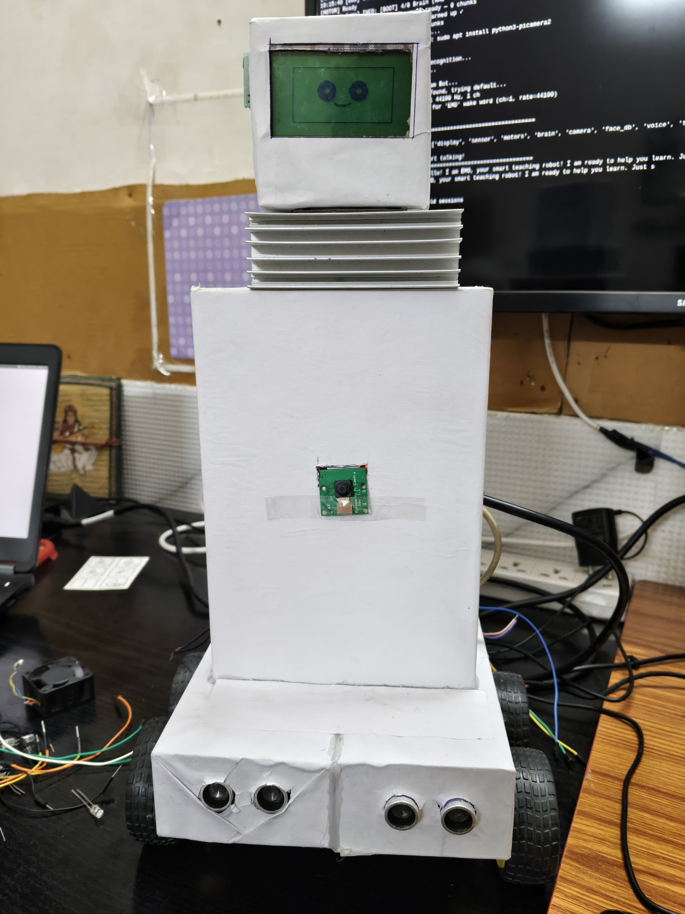
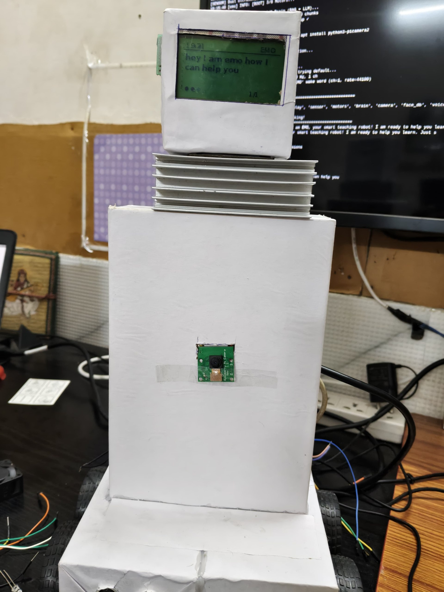
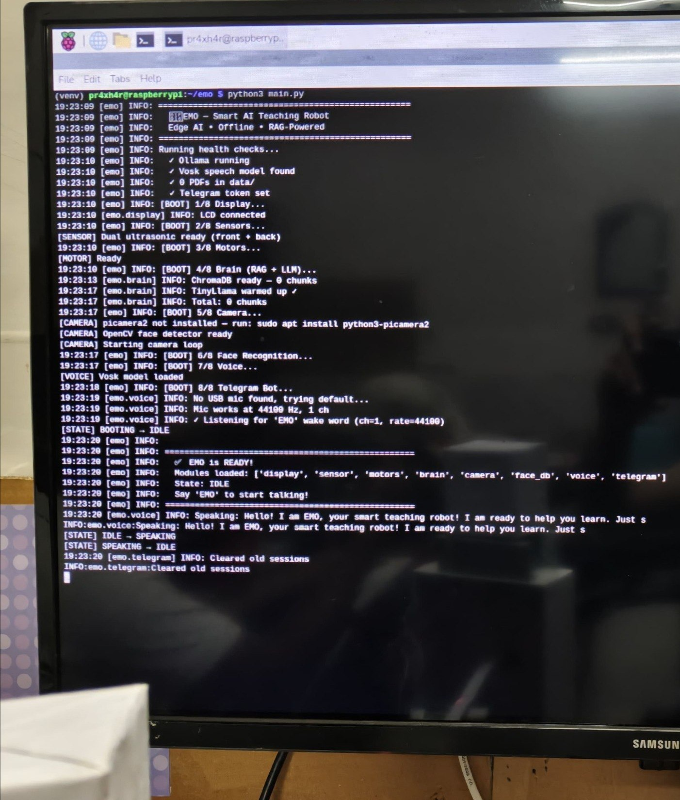
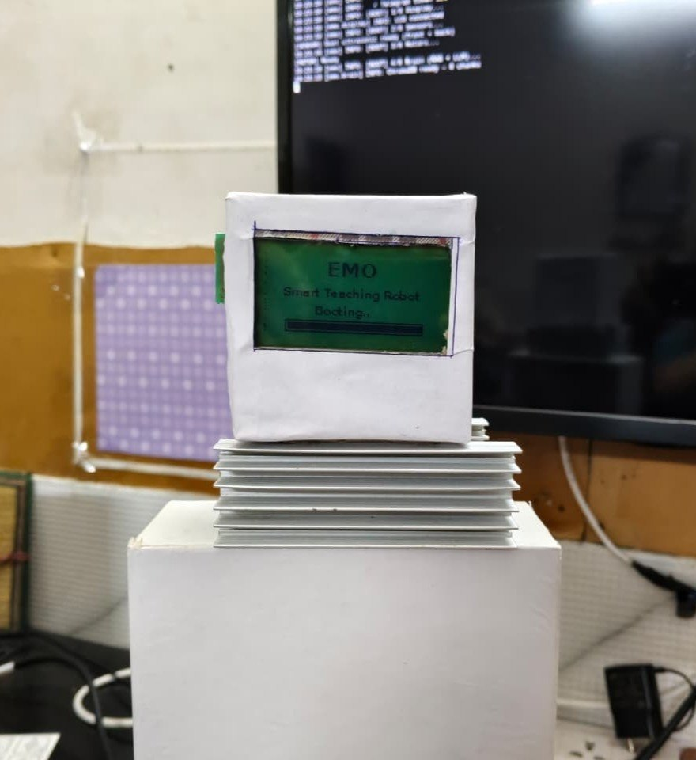

# EMO — Smart AI Teaching Robot 🤖

A Raspberry Pi-powered teaching robot that runs completely offline. EMO can answer questions from textbooks using RAG (Retrieval-Augmented Generation), recognize faces, follow people, patrol autonomously, and be controlled remotely via Telegram — all without an internet connection.

Built this as a project to explore edge AI and robotics. The idea was simple: build a robot that could actually help students learn, without needing cloud APIs or a fast internet connection.



## What it does

- **Voice interaction** — Say "EMO" to wake it up, then ask anything. It uses Vosk for offline speech recognition and pyttsx3 for text-to-speech.
- **AI-powered answers** — Uses TinyLlama running locally via Ollama. Questions are answered using RAG: upload PDFs (textbooks, notes) and EMO pulls relevant context before generating answers.
- **Face recognition** — Recognizes enrolled faces using OpenCV's LBPH recognizer. Say "remember me" and it saves your face. Next time, it greets you by name.
- **Autonomous movement** — Dual ultrasonic sensors for obstacle avoidance. Patrol mode, face-following mode, and line-following mode.
- **Animated LCD face** — 128x64 monochrome display shows expressive animated eyes that react to what EMO is doing (listening, thinking, speaking, error, etc.).
- **Telegram bot** — Full remote control panel. Upload PDFs, ask questions, drive the robot, take photos, check system status — all from your phone.
- **100+ voice commands** — Movement, quizzes, jokes, stories, fun facts, timers, games, and more.



## Hardware

| Component | Details |
|-----------|---------|
| Brain | Raspberry Pi 4 (4GB) |
| Display | 128x64 SPI LCD (ST7565 / UC1701) |
| Camera | Raspberry Pi Camera Module v1.3 |
| Motors | 2x DC motors via L298N driver |
| Sensors | 2x HC-SR04 ultrasonic (front + back) |
| Servo | SG90 for head pan |
| Microphone | USB mic |
| Speaker | 3.5mm speaker via Pi audio jack |
| Power | 12V battery pack + buck converter |
| Body | Cardboard + thermocol (it works!) |

## Software stack

- **Speech recognition:** Vosk (offline, ~40MB model)
- **Text-to-speech:** pyttsx3 + espeak
- **LLM:** TinyLlama via Ollama (runs on-device)
- **RAG pipeline:** ChromaDB for vector storage, pypdf for PDF parsing
- **Face detection:** OpenCV Haar Cascades
- **Face recognition:** OpenCV LBPH Recognizer
- **Display:** luma.lcd + Pillow
- **Telegram:** python-telegram-bot
- **Camera:** Picamera2 (libcamera)

## Project structure

```
emo/
├── main.py              # Main orchestrator — boot sequence, shutdown, logging
├── config.py            # All settings: GPIO pins, AI params, FAQ database
├── setup.sh             # One-shot setup script for Raspberry Pi
├── requirements.txt     # Python dependencies
├── modules/
│   ├── brain.py         # RAG pipeline — ChromaDB + TinyLlama
│   ├── voice.py         # Wake word detection, 100+ voice commands, TTS
│   ├── camera.py        # Face detection, line following, guard mode
│   ├── display.py       # Animated LCD eyes and text rendering
│   ├── motors.py        # DC motor + servo control, patrol, face following
│   ├── sensors.py       # Dual ultrasonic distance sensors
│   ├── face_db.py       # Face enrollment and recognition
│   └── telegram_bot.py  # Full Telegram admin panel
└── assets/              # Project photos
```

## Setup

**Requirements:** Raspberry Pi 4 (4GB+ RAM recommended), Raspberry Pi OS.

### 1. Clone and run the setup script

```bash
git clone https://github.com/pr4xh4r/emo.git
cd emo
bash setup.sh
```

The setup script handles everything: system packages, Python venv, pip dependencies, Vosk model download, SPI setup, and swap configuration.

### 2. Install and start Ollama

```bash
curl -fsSL https://ollama.com/install.sh | sh
ollama pull tinyllama
ollama serve
```

### 3. Configure your Telegram bot

Create a bot via [@BotFather](https://t.me/BotFather) on Telegram, then set your token:

```bash
export EMO_TELEGRAM_TOKEN="your_token_here"
```

Or edit `config.py` and replace `YOUR_BOT_TOKEN_HERE` with your token.

### 4. Add study material

Drop PDF files (textbooks, notes, etc.) into the `data/` folder. EMO will ingest them on startup and use them to answer questions via RAG.

### 5. Run

```bash
source venv/bin/activate
python3 main.py
```



## GPIO wiring

```
Raspberry Pi (BCM)          Component
──────────────────          ─────────
GPIO 5  (Pin 29)     →     LCD DC
GPIO 6  (Pin 31)     →     LCD RST
GPIO 8  (Pin 24)     →     LCD CS (SPI CE0)
GPIO 10 (Pin 19)     →     LCD MOSI
GPIO 11 (Pin 23)     →     LCD SCLK
GPIO 17 (Pin 11)     →     Motor IN1 (Left FWD)
GPIO 27 (Pin 13)     →     Motor IN2 (Left BWD)
GPIO 22 (Pin 15)     →     Motor IN3 (Right FWD)
GPIO 23 (Pin 16)     →     Motor IN4 (Right BWD)
GPIO 25 (Pin 22)     →     Motor ENA (Left PWM)
GPIO 26 (Pin 37)     →     Motor ENB (Right PWM)
GPIO 18 (Pin 12)     →     Servo (head pan)
GPIO 20 (Pin 38)     →     Ultrasonic TRIG (front)
GPIO 21 (Pin 40)     →     Ultrasonic ECHO (front)*
GPIO 19 (Pin 35)     →     Ultrasonic TRIG (back)
GPIO 16 (Pin 36)     →     Ultrasonic ECHO (back)*

* Use a voltage divider (1kΩ + 2kΩ) on ECHO pins — HC-SR04 outputs 5V!
```

## Voice commands

EMO responds to 100+ voice commands. Just say "EMO" to wake it up, then:

| Category | Example commands |
|----------|-----------------|
| Movement | "move forward", "go back", "turn left", "stop" |
| Patrol | "start patrol", "stop patrol" |
| Follow | "come here", "follow me" |
| Camera | "take a photo", "what do you see", "what color is this" |
| Face | "remember me", "who am I", "who do you know" |
| Fun | "tell me a joke", "dance", "sing a song", "surprise me" |
| Learning | "quiz me", "tell me a fact", "tell me a story" |
| Security | "guard this area", "stop guarding" |
| Utility | "what time is it", "set a timer", "volume up" |

Any question that doesn't match a command gets sent to the AI brain for a full answer.

## Telegram commands

Control EMO from your phone:

- `/ask <question>` — Ask EMO anything
- `/say <text>` — Display + speak text
- `/forward` `/backward` `/left` `/right` `/stop` — Drive
- `/patrol` — Toggle patrol mode
- `/photo` — Capture and send a photo
- `/text <content>` — Add text to knowledge base
- `/faq <q> | <a>` — Add instant FAQ
- `/status` — CPU, RAM, temperature, module status
- `/shutdown` — Graceful shutdown

Send a PDF file to automatically ingest it into the knowledge base.



## How the AI works

EMO uses a three-tier answer pipeline, optimized for speed on limited hardware:

1. **FAQ cache** — Common questions (greetings, science basics, jokes) get instant answers with zero latency. No LLM needed.
2. **RAG retrieval** — If the question isn't in the FAQ, EMO searches the ChromaDB vector store for relevant chunks from uploaded PDFs.
3. **TinyLlama generation** — The retrieved context (plus conversation history) is fed to TinyLlama running locally via Ollama. It generates a focused 2-3 sentence answer.

This keeps response times reasonable even on a Raspberry Pi 4.

## License

MIT
